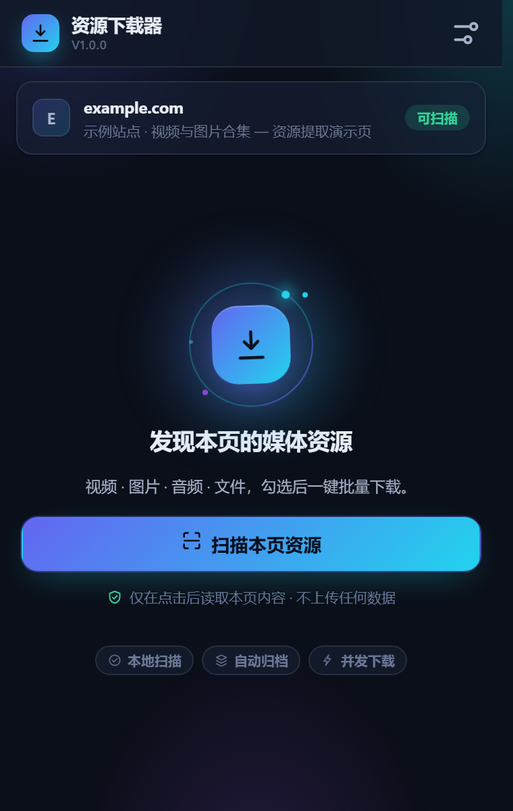
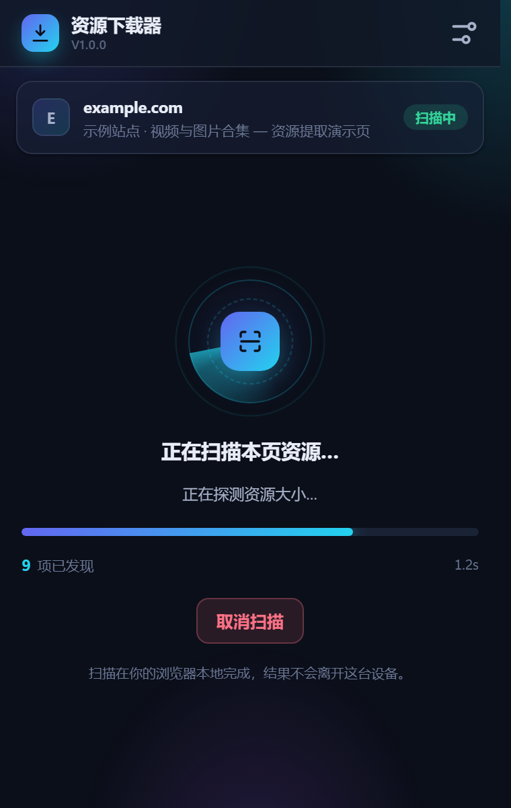
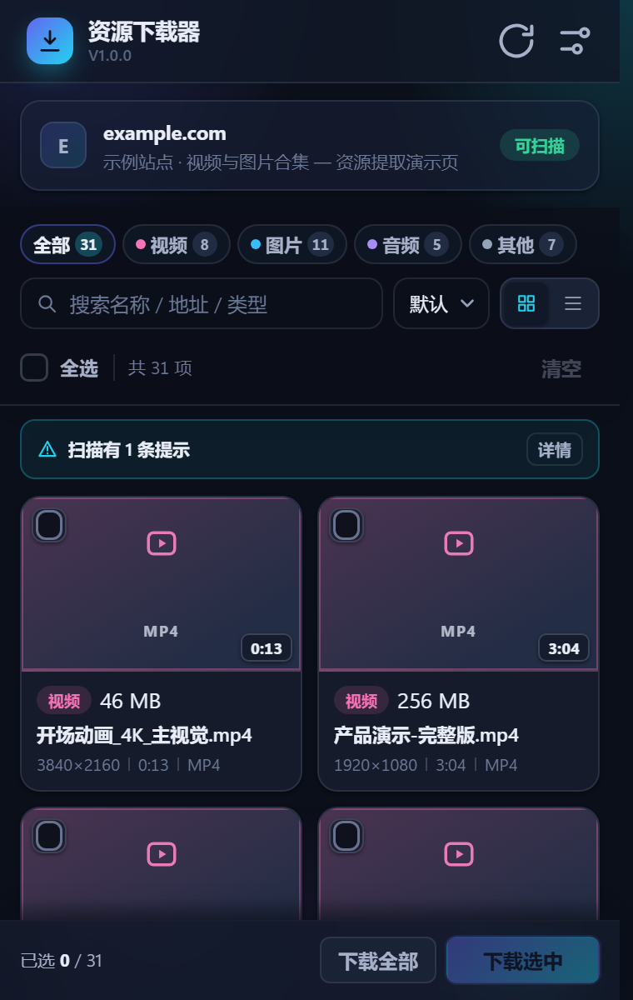
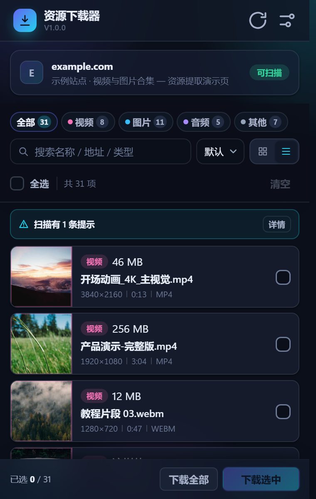
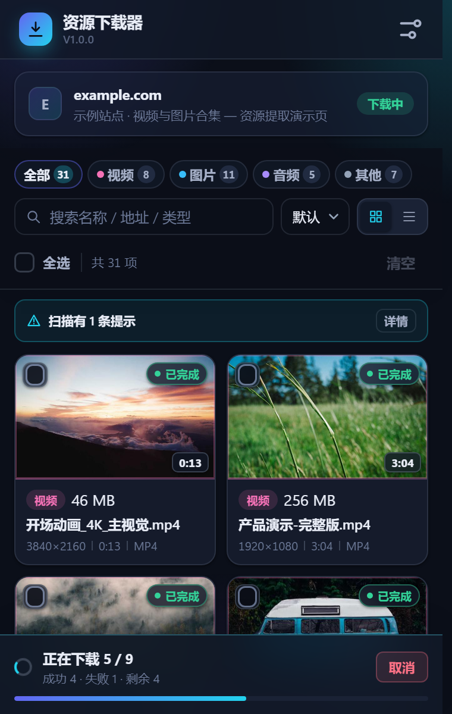
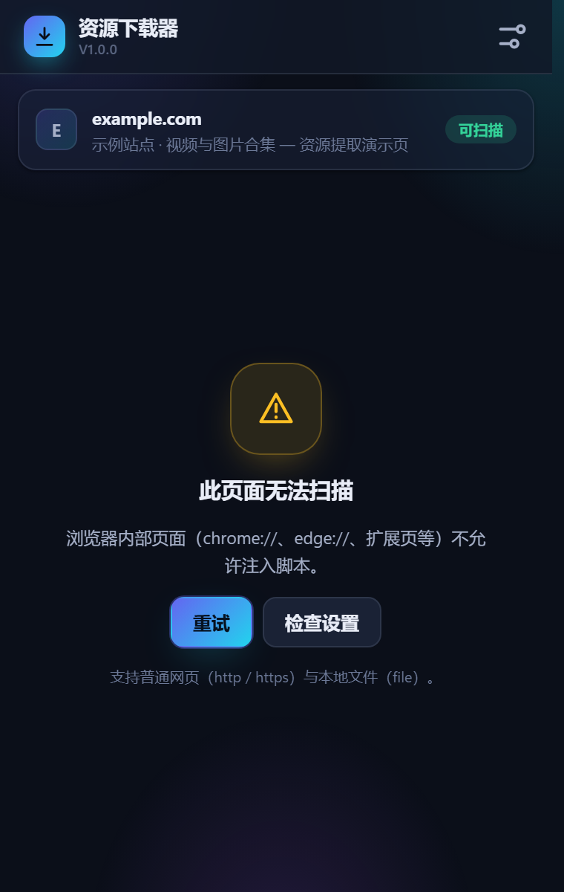
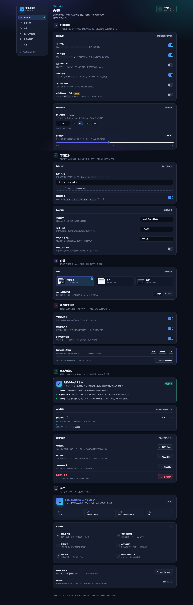
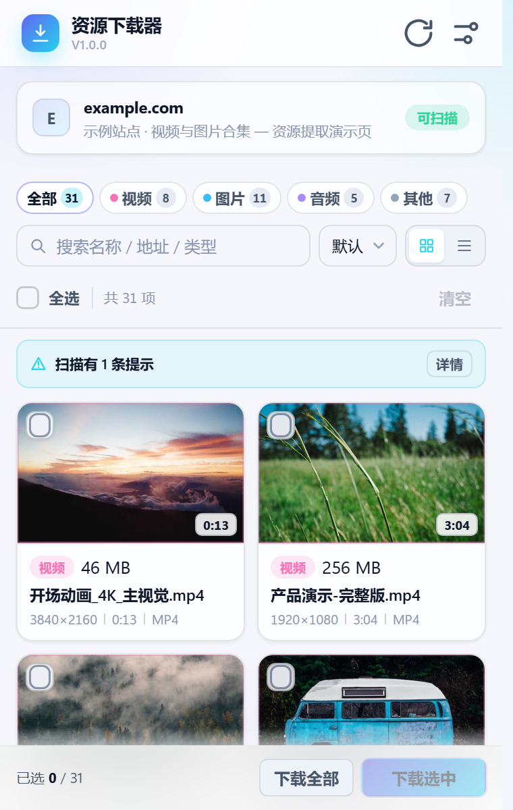

# Edge Resource Downloader · 资源下载器

> 一个 **Manifest V3** 浏览器扩展（Microsoft Edge / Chrome 通用），
> 把你当前页面里**真正可获取**的视频、图片、音频资源列出来，由你自由勾选后批量下载。

**隐私优先**：扩展在你**点击「扫描本页资源」按钮之前，不会读取页面中的任何资源**。
没有后台采集、没有埋点、没有网络请求上传。

---

## ✨ 功能

| 能力 | 说明 |
|---|---|
| 手动触发扫描 | 未点击按钮前保持 idle，绝不主动采集页面内容 |
| 全类型资源识别 | `` / `<video>` / `<audio>` / `<source>` / `<picture>` / `srcset` / CSS `background-image` / `og:image` 等 meta / `a[download]` / 网络请求中的媒体 / `m3u8`·`mpd` 流清单 |
| 智能去重与过滤 | URL 规范化去重；按最小尺寸过滤 1×1 埋点图；可过滤 base64 内联资源 |
| 可视化列表 | 网格 / 列表双视图，缩略图预览、类型标签、尺寸/时长/大小 |
| 自由勾选 | 类型筛选 + 搜索 + 排序 + 全选/反选，只下载你勾选的内容 |
| 批量下载 | 并发队列（1–8）、按类型自动分目录、同名文件策略、实时进度、可取消 |
| 精细设置 | 扫描范围、下载行为、外观主题、通知与快捷键、数据管理 |
| 精美 UI | 玻璃拟态 + 品牌渐变，深色/浅色主题自适应，细微动效 |

---

## 📸 界面预览

| 待机（点击前不采集） | 扫描中 | 结果（网格） |
|---|---|---|
|  |  |  |

| 结果（列表视图） | 下载中 | 无法扫描 |
|---|---|---|
|  |  |  |

| 设置页（深色） | 浅色主题 |
|---|---|
|  |  |

完整大图见 [docs/screenshots/](docs/screenshots/)（由 `node tests/screenshots.mjs` 在真实扩展上下文中生成）。

---

## 🚀 安装（开发者模式侧载）

1. 打开 `edge://extensions/`（Chrome 用 `chrome://extensions/`）。
2. 打开右上角 **开发人员模式 / Developer mode**。
3. 点击 **加载解压缩的扩展 / Load unpacked**，选择本目录
   `edge-plugins/resource-download`。
4. 工具栏出现图标，`Alt+Shift+R` 可直接打开面板。

> Edge 商店正式签名发布时可打包为 `.zip` 后上传开发者中心。

## 📖 使用

1. 在任意网页点击工具栏图标（或 `Alt+Shift+R`）。
2. 点击 **扫描本页资源** —— 此时才会开始读取页面。
3. 在结果列表中按类型筛选 / 搜索，勾选需要的资源。
4. 点击 **下载选中**。文件保存到 `下载目录/EdgeResourceDownload/<类型>/`。

> 页面不支持扫描时（`edge://`、`chrome://`、扩展页等）会给出明确提示。

## 🗂 目录结构

```
resource-download/
├── manifest.json           # MV3 清单
├── background.js           # Service Worker：扫描调度 / 下载队列 / 右键菜单 / 通知
├── content/scanner.js      # 注入式扫描器（仅在点击后 executeScript 注入）
├── lib/                    # 共享库（常量 / 工具 / 设置 / 消息 / 设计系统）
│   ├── constants.js
│   ├── utils.js
│   ├── settings.js
│   ├── messaging.js
│   └── theme.css
├── popup/                  # 主面板 UI
├── options/                # 设置页 UI
├── offscreen/              # 剪贴板兜底文档
├── icons/                  # 图标资产（16/32/48/128 + SVG 源）
├── tests/                  # 结构巡检 + E2E + 本地样例页
├── docs/                   # 契约文档、跨浏览器说明与截图
├── dist/                   # 打包产物（tests/package.mjs 生成）
├── LICENSE                 # MIT
└── .gitignore / .gitattributes
```

## ⚙️ 设置项一览

**扫描范围**：最小图片尺寸、扫描媒体标签、CSS 背景图、base64 内联资源、
流媒体清单、实验性 blob 导出、扫描 iframe、扫描超时。

**下载行为**：保存子文件夹、按类型分目录、同名策略（自动重命名/覆盖/询问）、
并发数（1–8）、单文件大小上限、扫描后自动全选。

**外观**：主题（跟随系统/浅色/深色）、默认视图（网格/列表）。

**通知与快捷键**：下载完成通知、右键菜单、快捷键 `Alt+Shift+R`、记住筛选条件。

**数据与隐私**：不收集任何数据；清空扫描历史、恢复默认设置、导出/导入设置 JSON。

## 🔐 隐私说明

* 扩展**不上传**任何数据，无远程代码，无第三方 SDK。
* 扫描动作**完全由你点击触发**；未点击时 Service Worker 不注入任何页面脚本。
* 扫描结果仅保存在 `chrome.storage.local`，最多保留最近 5 次摘要。
* 下载走浏览器原生 `chrome.downloads`，文件直接落盘到本地。

## 🧪 自测

```bash
node tests/run-all.mjs                 # 一键：结构巡检 → 扫描器专项 → 端到端 → 打包
node tests/check-structure.mjs         # 结构 / 契约 / manifest / 图标 静态巡检
node tests/e2e-scan.mjs                # 扫描器专项：取消、超时、不可扫描页、未点击不采集
node tests/e2e.mjs                     # 真实浏览器端到端（含失败路径与落盘校验）
node tests/screenshots.mjs             # 批量生成 docs/screenshots/
node tests/package.mjs                 # 打包 dist/*.zip（白名单，排除 dev/test 资产）
node tests/e2e.mjs --browser=chrome --headed --verbose   # 换 Chrome / 有头模式
```

测试在**真实 Edge**中加载扩展运行（CDP 驱动，无 npm 依赖）：

* 结构巡检 29 项：文件、manifest 字段、`_locales`、import 解析、必需 DOM id、
  无内联脚本、图标尺寸与 RGBA 通道、主题解析守卫。
* 扫描器专项 9 项：初始 `idle` 零采集、无效标签页结构化错误、取消扫描、自定义超时、设置往返。
* 端到端 42 项：真实点击 → 12 张卡片 → 批量下载 → **校验文件落盘到 `images/` `videos/` `audios/`**、
  失败路径（`done` 含 `failed` 语义回归防护）、设置页读写与主题即时生效、零未捕获异常。
* 打包 28 个文件（含 `LICENSE`），无 `tests/` `docs/` `dev-mock.js` `*.py` 泄漏；解压后可被 Edge 正常加载。

> 当前状态：**全部 4 套校验通过（51 项断言）**。

## 🌐 能否在 Google Chrome 上用？

**代码层面：可以。** 本扩展是标准 **Manifest V3**，只用了 Edge 与 Chrome 共有的
`chrome.*` API（36 个，全部在两边都有实现），没有任何 `ms-`/`browser.*` 私有调用。
Edge 本身就是 Chromium 分支，两边扩展模型一致：

| 维度 | Edge ↔ Chrome |
|---|---|
| 扩展格式 | 通用，同为 CRX3 / 解压目录 |
| Manifest V3 | 通用 |
| 所用 API（`downloads` `scripting` `offscreen` `storage` …） | 通用，无差异 |
| `_locales` 多语言 | 通用 |
| popup / options / service worker | 通用 |
| 商店上架 | **不通用**，各自独立审核、独立 ID |
| 内部页协议 | **运行时差异**：Edge 是 `edge://`，Chrome 是 `chrome://`（代码已按 UA 分支） |
| `chrome.action.openPopup()` | **行为差异**：Chrome 限制更严（需 127+ 且依赖用户手势） |

**实际使用注意两点：**

1. **手动侧载可用**。解压后在 `chrome://extensions` 打开「开发者模式」→
   「加载已解压的扩展程序」选择本目录即可，功能与 Edge 上一致。
   ⚠️ 但 **Chrome 137+ 已移除 `--load-extension` 命令行开关**（用于自动化测试），
   该参数在新版 Chrome 上会被静默忽略——所以本仓库的自动化 E2E 默认跑 Edge。
2. **想上架需分别提交**。同一个 `dist/*.zip` 可以同时上传到
   [Edge 加载项商店](https://microsoftedge.microsoft.com/addons) 和
   [Chrome 网上应用店](https://chromewebstore.google.com/)，但两边审核独立、分配不同扩展 ID。

## 🛠 开发

* 所有 UI 颜色来自 `lib/theme.css` 的 CSS 变量，禁止硬编码。
* 跨模块接口见 `docs/CONTRACT.md`（常量、消息、数据模型、必需 DOM id）。
* 跨浏览器差异（Edge / Chrome）见 `docs/CROSS-BROWSER.md`。
* 修改后请跑 `node tests/check-structure.mjs` 再提交。
* 静态巡检会校验 **manifest 权限与代码里用到的 `chrome.*` API 是否一致**
  （漏声明权限会让 API 变成 `undefined`、功能静默失效）。
* E2E 支持切换内核：`node tests/e2e.mjs --browser=chrome`（需该 Chrome 版本仍接受
  `--load-extension`；Chrome 137+ 不再支持，此时请用 Edge 或手动侧载验证）。

## 已知限制

* 浏览器内部页面（`edge://` / `chrome://`）无法注入脚本，不支持扫描。
* 受 CORS 限制，部分跨域资源无法探测大小（列表显示 `—`），但下载仍由浏览器完成。
* `blob:` 媒体需开启「实验性 blob 导出」，且依赖页面仍存活。
* DRM 保护流（Widevine 等）无法下载。
* HLS/DASH 仅列出清单地址，不做分片合并（可用 ffmpeg 等工具后续处理）。
* **剪贴板复制**依赖 popup 处于聚焦状态（用户点击瞬间成立）。后台 offscreen
  文档永远没有焦点，`execCommand` 与 `writeText` 在那里都会失败，
  因此代码把 popup 直写作为主路径、offscreen 仅作兜底。

## 许可

MIT License
